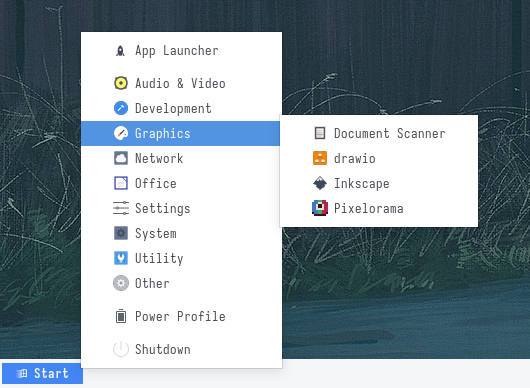

# Go, Waybar Sidecar!
<p align="center">
  
</p>

Generates configs for Waybar, reloads on css update, creates menus, generates applications list, power switcher and session controls.



- Small resource usage: ~0.0% CPU, ~10 MB RAM. It's a bit worse than bash + inotify (RSS is for really used RAM):

  ```table
  USER         PID %CPU %MEM    VSZ   RSS TTY      STAT START   TIME COMMAND
  nett00n     1823  0.0  0.0   6944  3732 tty2     S+   Jun14   0:00 inotifywait -m -r -e modify,create,delete /home/nett00n/.config/waybar/
  nett00n   581250  0.0  0.0 1784092 10600 ?       Sl   10:18   0:00 go-waybar-sidecar
  ```
- Generates configuration from YAML file. I really *hate* json files as human-writable configuration format :)
- Monitors configuration and style files in config folder and reloads Waybar in place via `SIGUSR2` (starts it if not running). Waybar itself does not watch its files ([discussion](https://github.com/Alexays/Waybar/issues/961)).
- Generates gtk3-menu XML files from YAML with actions and submenus. This unifies Waybar configuration in one place.
- Generated menu entries: installed applications (plain or by category, with icons), power profiles, session actions (lock, suspend, reboot, ...).
- Supervises Waybar: restarts it if it dies, stops it on exit, takes over from an older sidecar instance.
- Cron-like jobs scheduler (`jobs:` in `config.yaml`) that run shell commands and write their output to files, e.g. for `custom/exec` modules.
- Settings via `sidecar:` in `config.yaml`, environment variables or flags.
- Optional clickable desktop notifications (mako, dunst, swaync, etc).
- Config generation is optional: `--no-generate` only watches and reloads Waybar.

[Feature Requirements Document](./docs/FRD.md) is a source of features truth. See also the [changelog](./docs/CHANGELOG.md).

Suspiciously, code has an LLM aftertaste.

## Installation

Requires `waybar`.

Prebuilt Linux binary (`amd64` or `arm64`) from the rolling `latest` release (built from `main`); use `releases/latest/download` for the newest tagged version:

```sh
arch=$(uname -m | sed 's/x86_64/amd64/;s/aarch64/arm64/')
curl -fL -o ~/.local/bin/go-waybar-sidecar \
  "https://github.com/5mdt/go-waybar-sidecar/releases/download/latest/go-waybar-sidecar-linux-$arch"
chmod +x ~/.local/bin/go-waybar-sidecar
```

From source (requires Go), installs to `~/.local/bin`:

```sh
make install
```

## First run

On first start the sidecar writes a sample `~/.config/go-waybar-sidecar/config.yaml` and generates `~/.config/waybar/config.jsonc` from it. Your existing `config.jsonc` is saved as `config.jsonc.bak`.

To reuse your own Waybar config, convert it to YAML (e.g. `yq -P config.jsonc`) and put it under the `waybar:` key in that file.

## Usage

```sh
go-waybar-sidecar --help
```

## License

[GPLv3](./LICENSE.md)

## Authors

5mdt team (sorted alphabetically):

- [@nett00n](https://github.com/nett00n)
